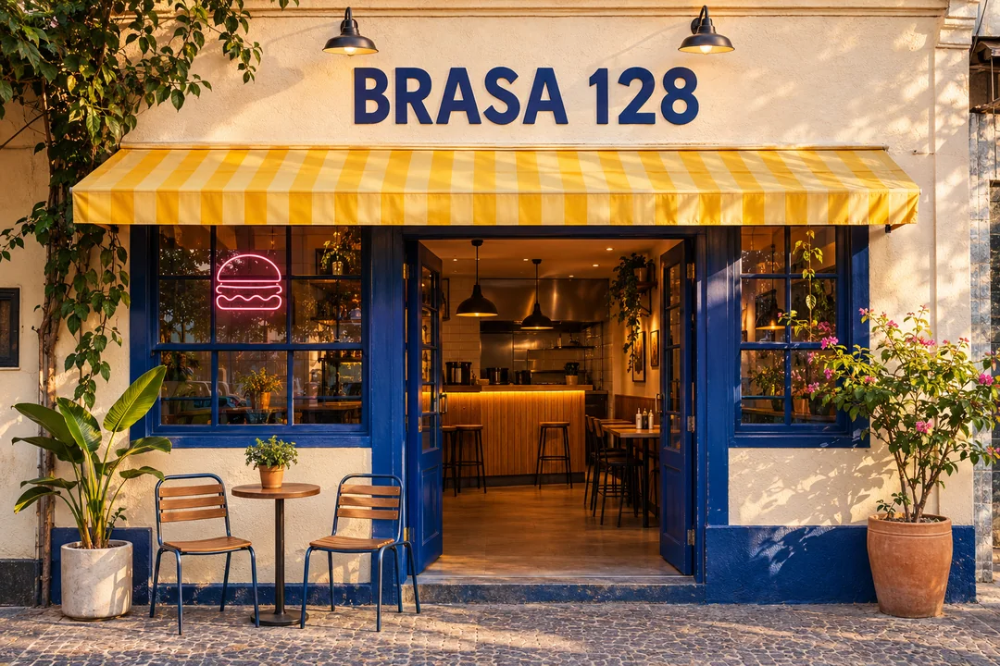

# Guia para aplicar o estilo da landing do QR Cardápio

Use este guia ao criar uma página que deve parecer parte do QR Cardápio. A identidade aparece na combinação de fundo creme, títulos de alto contraste, bordas escuras, ações coloridas e imagens que mostram o produto ou o negócio. Comece pela função da nova página e escolha os elementos que ajudam o usuário a agir.

## 1. Cores e superfícies

A fonte de verdade para a landing é [landing.css](../../static/css/landing.css). Os tokens de base usados no restante do produto ficam em [tokens.css](../../static/css/tokens.css).

- `--landing-paper: #fff9ee` é o fundo das páginas comerciais e dos cartões claros.
- `--landing-ink: #161721` é a cor dos títulos, textos principais, bordas e sombras duras.
- `--landing-blue: #263be8` identifica a ação principal e pode preencher uma seção de destaque. Sobre esse azul, use texto branco.
- `--landing-yellow: #ffdc38` destaca chamadas, dados ou ações sobre uma área azul. Use texto escuro.
- `--landing-pink: #ff5596` funciona como segundo destaque. Use texto escuro.
- `--landing-rule: #ded4c4` separa grupos de conteúdo sem competir com as bordas dos cartões.

As bordas da landing normalmente têm 2 px. Use raio de aproximadamente 13 px em botões e 16 px em cartões. Nas superfícies de destaque, aplique uma sombra escura sem desfoque, deslocada 3 a 6 px. Reserve essa sombra para elementos que precisam de ênfase.

## 2. Tipografia, espaço e hierarquia

Use `--font-sans` para manter a mesma pilha de fontes do sistema. Na landing, o título de abertura usa peso 900 e escala fluida, enquanto títulos de seção têm menos contraste de tamanho e os parágrafos mantêm pelo menos 16 px. Comece com a escala e ajuste quando o conteúdo pedir.

- Escreva um título que diga o que a pessoa pode fazer na página.
- Escolha uma ação principal por seção. Ações secundárias podem ter fundo creme, texto escuro e contorno.
- Use até cerca de `45ch` para parágrafos de abertura. Deixe os textos seguirem para a próxima linha quando o idioma exigir.
- Alinhe as seções com `.landing-container`. Ela limita a largura a `92rem` e ajusta as margens laterais conforme a tela.
- Use duas colunas quando texto e visual se complementam. Empilhe o conteúdo quando a leitura pedir mais espaço. Na landing, `53rem` é a referência para empilhar a abertura e `36rem` para alguns grupos de cartões.

## 3. Imagens, ícones e dados de exemplo

Use fotografias com luz quente e enquadramento natural quando a página mostrar um estabelecimento ou seus produtos. Para demonstrações, use capturas reais do produto com dados fictícios. Ilustrações de estado podem reaproveitar o personagem e os contornos de [state-empty.svg](../../static/images/state-empty.svg) e das demais artes de erro.

Os ícones vetoriais da landing ficam em [landing.svg](../../static/icons/landing.svg) e os do painel em [dashboard.svg](../../static/icons/dashboard.svg). Use a família correspondente ao contexto. Ícones decorativos ficam ocultos para leitores de tela e acompanham rótulos visíveis nas ações.

Forneça dimensões nas imagens, prefira WebP para fotos e use `loading="lazy"` abaixo da primeira dobra. Use texto alternativo quando a imagem comunicar informação e `alt=""` quando o texto ao lado já transmitir o conteúdo. Identifique claramente os nomes e números simulados, como na ficha da Brasa 128.

## 4. Como reaproveitar no projeto

1. Estenda [layouts/base.html](../../templates/layouts/base.html) para uma página comercial e carregue `/static/css/landing.css` no bloco `head_extra`.
2. Use `class="landing-page"` no `main` para ativar os tokens da landing. Reaproveite `.landing-container`, `.landing-hero`, `.landing-section-heading` e `.landing-button` conforme a função da página.
3. Mantenha folhas auxiliares separadas quando precisar de uma composição específica, como [landing-maps.css](../../static/css/landing-maps.css) para a comparação de avaliações.
4. No painel, mantenha o layout e os controles de [dashboard.css](../../static/css/dashboard.css). Leve a identidade para ícones, ilustrações de estado e destaques, com a barra lateral e as ações do painel no lugar.
5. Em cardápios públicos, preserve `--brand-accent` e `--brand-accent-ink` do estabelecimento. Reaproveite a linguagem visual nas bordas, espaçamentos e imagens.

Esta estrutura reaproveita o cabeçalho, os estilos e as chaves de tradução que já existem no projeto.

```html



<link rel="stylesheet" href="/static/css/landing.css">



<main id="main-content" class="landing-page">
  <section class="landing-container landing-hero">
    <div>
      <h1 data-i18n="maps.heading">{{ page.t("maps.heading") }}</h1>
      <p class="landing-hero-description" data-i18n="maps.subtitle">
        {{ page.t("maps.subtitle") }}
      </p>
      <a class="btn landing-button landing-button-blue" href="/register"
         data-i18n="landing.create_menu">{{ page.t("landing.create_menu") }}</a>
    </div>
    
  </section>
</main>

```

Troque o título, o texto, a imagem e o destino do botão conforme a página. Coloque as novas chaves nos três catálogos. Use `data-i18n` para texto e `data-i18n-alt` para descrições de imagens que precisam mudar com o idioma. Mantenha CSS e scripts em arquivos externos.

## 5. Como levar o estilo para outro projeto

Copie os seis valores da paleta para o escopo da nova página. Ligue a pilha de fontes do sistema, o contêiner responsivo e os cartões aos mesmos tokens. Este trecho funciona como base para HTML independente ou componentes React.

```css
.qr-page {
  --paper: #fff9ee;
  --ink: #161721;
  --blue: #263be8;
  --yellow: #ffdc38;
  --pink: #ff5596;
  --rule: #ded4c4;
  background: var(--paper);
  color: var(--ink);
  font: 1rem/1.5 system-ui, sans-serif;
}

.qr-container {
  width: min(92rem, calc(100% - clamp(2rem, 7vw, 7rem)));
  margin-inline: auto;
}

.qr-card {
  padding: clamp(1rem, 2vw, 1.6rem);
  background: var(--paper);
  border: 2px solid var(--ink);
  border-radius: 1rem;
}

.qr-primary {
  display: inline-flex;
  align-items: center;
  box-sizing: border-box;
  min-height: 44px;
  padding: 0.65rem 1rem;
  border: 2px solid var(--ink);
  border-radius: 0.8rem;
  box-shadow: 3px 4px 0 var(--ink);
  background: var(--blue);
  color: #fff;
  font-weight: 800;
  text-decoration: none;
}

.qr-page :focus-visible {
  outline: 3px solid var(--blue);
  outline-offset: 3px;
}
```

## Revisão antes de publicar

- Confira a página em um celular de 360 px, em uma tela intermediária e no desktop. Verifique que textos, cartões e ações continuam visíveis sem rolagem horizontal.
- Percorra todos os controles com teclado. Mantenha o foco visível, contraste legível e alvos de pelo menos 44 px nas ações principais.
- Alterne entre português, inglês e espanhol para conferir textos longos, descrições de imagens e unidades numéricas.
- Compare a página com a landing. Procure a paleta, o peso dos títulos, o tratamento das bordas e a direção das imagens. Use esses elementos a serviço da ação principal da nova tela.
